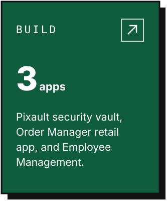
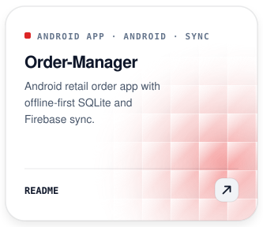
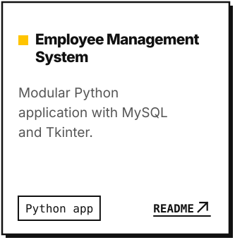
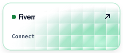
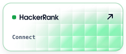

<!-- AUTO-GENERATED by scripts/build.py. Edit profile.config.json, then run: python scripts/build.py -->

<a href="https://portfoliotv.vercel.app"><picture><source media="(prefers-color-scheme: dark)" srcset="assets/dark/hero.svg"><source media="(prefers-color-scheme: light)" srcset="assets/light/hero.svg"></picture></a>

<a href="https://github.com/tarun-suthar-04"><picture><source media="(prefers-color-scheme: dark)" srcset="assets/dark/heatmap.svg"><source media="(prefers-color-scheme: light)" srcset="assets/light/heatmap.svg"></picture></a>

<a href="https://github.com/tarun-suthar-04"><picture><source media="(prefers-color-scheme: dark)" srcset="assets/dark/stats.svg"><source media="(prefers-color-scheme: light)" srcset="assets/light/stats.svg"></picture></a>

<a href="https://github.com/tarun-suthar-04?tab=repositories"><picture><source media="(prefers-color-scheme: dark)" srcset="assets/dark/tile-build.svg"><source media="(prefers-color-scheme: light)" srcset="assets/light/tile-build.svg"></picture></a><a href="https://leetcode.com/u/tarun_suthar/"><picture><source media="(prefers-color-scheme: dark)" srcset="assets/dark/tile-solve.svg"><source media="(prefers-color-scheme: light)" srcset="assets/light/tile-solve.svg"></picture></a><a href="https://portfoliotv.vercel.app"><picture><source media="(prefers-color-scheme: dark)" srcset="assets/dark/tile-create.svg"><source media="(prefers-color-scheme: light)" srcset="assets/light/tile-create.svg"></picture></a>

<picture><source media="(prefers-color-scheme: dark)" srcset="assets/dark/tech.svg"><source media="(prefers-color-scheme: light)" srcset="assets/light/tech.svg"></picture>

<picture><source media="(prefers-color-scheme: dark)" srcset="assets/dark/how-i-work.svg"><source media="(prefers-color-scheme: light)" srcset="assets/light/how-i-work.svg"></picture>

<a href="https://github.com/tarun-suthar-04?tab=repositories"><picture><source media="(prefers-color-scheme: dark)" srcset="assets/dark/coding-label.svg"><source media="(prefers-color-scheme: light)" srcset="assets/light/coding-label.svg"></picture></a>

<a href="https://github.com/tarun-suthar-04/Project_Pixault"><picture><source media="(prefers-color-scheme: dark)" srcset="assets/dark/project-pixault.svg"><source media="(prefers-color-scheme: light)" srcset="assets/light/project-pixault.svg"></picture></a><a href="https://github.com/tarun-suthar-04/Order-Manager"><picture><source media="(prefers-color-scheme: dark)" srcset="assets/dark/project-order-manager.svg"><source media="(prefers-color-scheme: light)" srcset="assets/light/project-order-manager.svg"></picture></a><a href="https://github.com/tarun-suthar-04/EmployeeManagementSystem"><picture><source media="(prefers-color-scheme: dark)" srcset="assets/dark/project-employee-management.svg"><source media="(prefers-color-scheme: light)" srcset="assets/light/project-employee-management.svg"></picture></a>

<a href="https://www.linkedin.com/in/tarun-suthar-307838266"><picture><source media="(prefers-color-scheme: dark)" srcset="assets/dark/contact-linkedin.svg"><source media="(prefers-color-scheme: light)" srcset="assets/light/contact-linkedin.svg"></picture></a><a href="https://www.fiverr.com/tarun_suthar"><picture><source media="(prefers-color-scheme: dark)" srcset="assets/dark/contact-fiverr.svg"><source media="(prefers-color-scheme: light)" srcset="assets/light/contact-fiverr.svg"></picture></a><a href="https://www.hackerrank.com/profile/tarun_suthar"><picture><source media="(prefers-color-scheme: dark)" srcset="assets/dark/contact-hackerrank.svg"><source media="(prefers-color-scheme: light)" srcset="assets/light/contact-hackerrank.svg"></picture></a><a href="https://leetcode.com/u/tarun_suthar/"><picture><source media="(prefers-color-scheme: dark)" srcset="assets/dark/contact-leetcode.svg"><source media="(prefers-color-scheme: light)" srcset="assets/light/contact-leetcode.svg"></picture></a>

